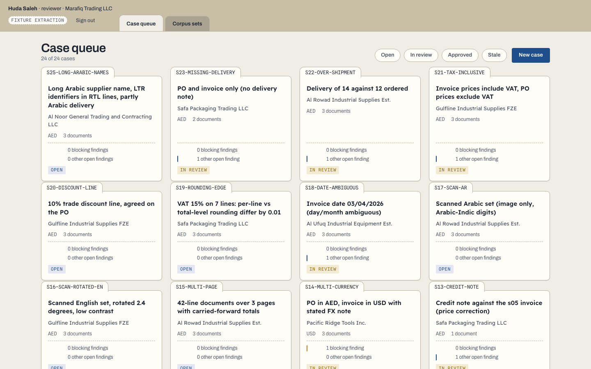

# Invoice Reconciliation

**Three documents. One explainable decision.**

An invoice total can look plausible while individual lines disagree with the purchase order or delivery. This review desk makes the evidence and the exception visible before approval.

Built by **Mohammed Abumtary** · TypeScript · React · Hono · PostgreSQL · PDF.js · extraction worker

[Demo guide](docs/DEMO.md) · [Engineering notes](docs/ENGINEERING.md) · [Verification & boundaries](docs/VERIFICATION.md) · [Recorded walkthrough](media/walkthrough.mp4)

## The experience

Open a packet → compare lines → inspect an exception → approve or resolve.

English/Arabic synthetic document packets. Fixture extraction and real text-layer parsing are distinct modes; image-only OCR remains unverified.

## Where the engineering matters

### Link values back to the document

Extracted fields and line items carry page-region references so a reviewer can inspect where a number came from.

### Make ambiguity explicit

Short delivery, changed price, unit mismatch and ambiguous dates become exceptions with reviewer dispositions instead of silent normalization.

### Keep review and approval separate

Corrections, document versions and final approval form an auditable case before report export.

## Verified in the demonstration

- Nine database regressions and six browser checks passed in the current verification pass.
- A synthetic 25-set corpus includes price, quantity, unit, currency, duplication and hostile-file cases.
- Text-layer evaluation on the generated corpus recorded 517/542 header fields and 1,786/1,798 line cells matching after normalization.

## Explore the work

This repository is a presentation package: screenshots, walkthrough media and engineering notes. Application source, credentials and customer records are not included. The interactive demonstration runs in a separate local review environment; access can be arranged for a walkthrough.

[Read the guided demo](docs/DEMO.md) · [View my portfolio](https://mohammed-ab.github.io/)

## Scope

Those extraction figures apply only to the generated corpus. Real supplier layouts, scanned OCR and human Arabic review are not established by these results.

Reviewed 10 November 2026. Results describe the recorded build and stated test scope.
